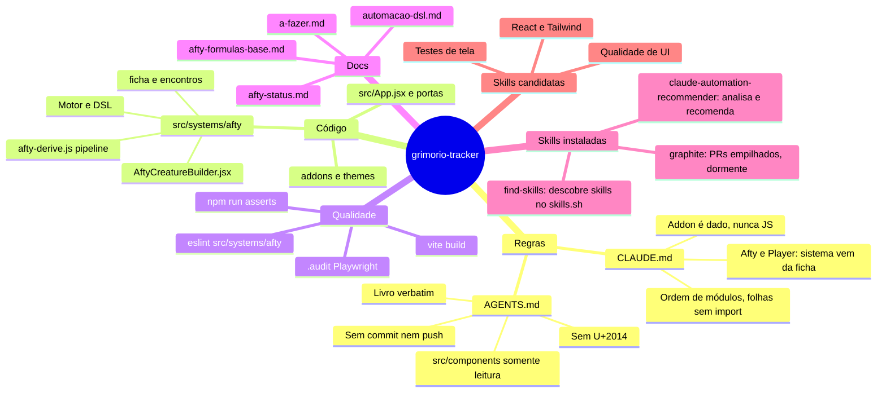

# Mapa de skills do projeto (2026-10-29)

Relatório da instalação e da execução de três skills de agente neste repositório, mais um mapa mental e candidatas extras.
Nada aqui altera código, `package.json`, lockfiles ou docs de regra. Sem commit nem push.

## 1. O que foi instalado e de onde

Convenção encontrada: o projeto só tinha `.claude/settings.json` e `.claude/settings.local.json` (sem `.agents/`). Skills foram para
`.claude/skills/<nome>/SKILL.md`, o padrão do Claude Code. A pasta `.claude/` está no `.gitignore` (linha "Arquivos locais e de IA"),
então a instalação é local e não entra no repositório. Para a equipe compartilhar, o autor decide se tira `.claude/skills` do ignore.

Método: nenhuma instalação via `npx` ou script remoto. Cada fonte oficial foi clonada em `/tmp` (pasta nova, fora do projeto),
o conteúdo foi lido e conferido por `grep` (sem `curl`, `wget`, `eval`, `rm -rf` nos arquivos de skill) e só então copiado.

| Skill pedida | Pacote exato e fonte oficial | Commit inspecionado | Instalada em | Estado |
|---|---|---|---|---|
| Graphite | `graphite` em `withgraphite/agent-skills` (org oficial da Graphite, 9.970 instalações no skills.sh) | `df3c9a3` (2026-02-17) | `.claude/skills/graphite/` | Instalada, NÃO aplicável hoje (ver 3) |
| Skill.sh | O site `skills.sh` e o CLI npm `skills` (`vercel-labs/skills`, MIT, v1.7.4). A skill de agente do pacote é `find-skills` | `92a9a34` | `.claude/skills/find-skills/` | Instalada e usada |
| Claude Code Setup | Plugin `claude-code-setup` (skill `claude-automation-recommender`) em `anthropics/claude-plugins-official`, autoria Anthropic | `f8c5e7a` | `.claude/skills/claude-automation-recommender/` (SKILL.md e 5 referências) | Instalada e usada |

Observações de identidade:
- Existe um fork de terceiro (`JPDesignTech/graphite-skill`, 15 instalações) que traz hooks e um `.mcp.json` rodando `gt mcp`. Foi descartado: a oficial é a da `withgraphite`.
- "Skill.sh" não é uma skill, é o diretório/CLI (`npx skills add <owner/repo>`). A skill oficial que o acompanha é `find-skills`.
- Não foi instalado o plugin pelo marketplace (`/plugin install claude-code-setup@claude-plugins-official`) porque isso é comando interativo do Claude Code do autor, e a cópia direta dá o mesmo conteúdo.

## 2. O que realmente foi rodado

| Item | Resultado |
|---|---|
| Leitura de AGENTS.md, CLAUDE.md, cabeçalhos dos 3 docs obrigatórios (`afty-status.md`, `automacao-dsl.md`, `afty-formulas-base.md`) | Feita antes de qualquer escrita. Docs lidos por índice de seções e a sessão de 2026-10-27, não integralmente |
| `git clone --depth 1` das três fontes em `/tmp/sk_raw/*` | OK |
| Cópia dos três diretórios para `.claude/skills/` | OK, 8 arquivos |
| `find-skills`: consulta à API pública de busca do skills.sh (`/api/search?q=`) com os termos react, tailwind, playwright, vercel, frontend design, accessibility | OK, usada no lugar de `npx skills find` para não executar o pacote npm |
| `claude-automation-recommender`: etapa 1 (análise da base) feita à mão seguindo o SKILL.md: tipo de projeto, dependências, config existente | OK, resultado em 4 |
| `graphite`: checagem de pré-requisito do próprio SKILL.md (`.git/.graphite_repo_config`) e do `gt` | Arquivo ausente, `gt` não instalado. A skill diz que nesse caso NÃO se aplica. Nenhum comando `gt` rodado |
| `npx skills add/find`, `npm install`, `gt`, builds, lint, asserts | Não rodados (fora do escopo) |

## 3. Graphite: por que está instalada mas dormente

- O repositório não é gerenciado pelo Graphite e `gt` não está no PATH.
- A skill manda criar branches/commits/PRs (`gt create`, `gt submit`, `gt modify`), o que colide com a regra do AGENTS.md: o agente nunca roda `git commit` nem `git push`, e o deploy é o push para `main`.
- Uso seguro: só sob pedido explícito do autor, e mesmo assim o agente prepara e o humano comita. Se o autor não quiser a skill no contexto, basta apagar `.claude/skills/graphite/`.

## 4. Análise do repositório pelo Claude Code Setup (somente leitura)

Base: SPA Vite 8, React 18, Tailwind 4, ESLint 9, lucide-react, sem backend, deploy Vercel por push em `main`, motor próprio em `src/systems/afty/`
(96 itens na raiz), suíte própria `asserts/*.mjs`, Playwright solto em `.audit/` (fora do `package.json`). Config existente: `.claude/settings*.json`, CLAUDE.md denso.

Recomendações (1 a 2 por categoria, como manda a skill):

| Categoria | Recomendação | Observação para este projeto |
|---|---|---|
| Hooks | PostToolUse que roda `npx eslint` no arquivo editado em `src/systems/afty/` | Lint do Afty está limpo, então vira rede de proteção barata |
| Hooks | PreToolUse que bloqueia escrita em `src/components/` e `src/data/enciclopedia-digital-*.json` | Regra de ouro do AGENTS.md. Exige ressalva para as exceções da seção 6 |
| Hooks (opcional) | Verificador de U+2014 no diff | Hoje só se confere à mão |
| Subagentes | Revisor de isolamento (diff fora de `src/systems/afty/`, U+2014, ponto e vírgula em UI) | Replica o checklist da seção 4 do AGENTS.md |
| Subagentes | Revisor de ordem de módulos (roda `node asserts/t-ordem-modulos.mjs` ao mexer em import) | Pega a tela branca por ciclo de import |
| Skills | `frontend-design` já é citada no CLAUDE.md (só sob pedido) | Manter assim |
| MCP | Context7 para docs de Vite/React/Tailwind 4 | Útil, sem segredo |
| MCP | Playwright MCP, no lugar dos scripts soltos de `.audit/` | Playwright já está instalado, mas fora do `package.json` |

Nada disso foi criado. É lista para o autor aprovar.

## 5. Mapa mental



Versão em texto:

```
grimorio-tracker
|- Regras: AGENTS.md (manda), CLAUDE.md (arquitetura e armadilhas)
|- Código: App.jsx -> systems/afty (derive, motor, DSL, builder, ficha, encontros) + addons + themes
|- Qualidade: eslint do Afty, vite build, npm run asserts, .audit (Playwright)
|- Docs: afty-status (histórico), a-fazer (fila), automacao-dsl, afty-formulas-base
|- Skills: recommender (análise), find-skills (busca), graphite (dormente)
`- Candidatas: ver seção 6
```

## 6. Skills adicionais candidatas

Fonte: busca no skills.sh em 2026-10-29. Nenhuma foi instalada, nenhuma foi inspecionada além do nome/contagem. Antes de instalar, clonar, ler o SKILL.md e conferir o repositório (regra do próprio `find-skills`: desconfiar de repo com menos de 100 estrelas).

| Candidata | Fonte | Instalações | Compatibilidade com o projeto | Ressalva |
|---|---|---|---|---|
| `frontend-design` | `anthropics/skills` | 1.045.542 | Alta, mas o CLAUDE.md já restringe: roda só sob pedido, e as regras de UI do Afty vencem | Pode sugerir texto explicativo, travessão ou estilos que a casa proíbe |
| `vercel-react-best-practices` | `vercel-labs/agent-skills` | 849.926 | Boa para React 18 e performance do `AftyCreatureBuilder.jsx` (18 mil linhas) | Algumas regras miram Next.js, aqui é Vite SPA |
| `deploy-to-vercel` | `vercel-labs/agent-skills` | 173.904 | Baixa: o deploy é push do autor, o agente não publica | Só leitura/consulta |
| `playwright-cli` | `microsoft/playwright-cli` | 199.295 | Média: substitui os scripts soltos de `.audit/` | Playwright não está no `package.json` e instalar dependência exige autorização |
| `playwright-best-practices` | `currents-dev/playwright-best-practices-skill` | 99.564 | Média, mesmo motivo | Confirmar repositório |
| `tailwind-design-system` | `wshobson/agents` | 70.959 | Baixa a média: o `index.css` global fora de `@layer` e o sufixo `!` são particularidades locais | Pode sugerir editar `index.css`, o que o CLAUDE.md proíbe |
| `tailwind-4-docs` | `lombiq/tailwind-agent-skills` | 17.778 | Média, referência do Tailwind 4 | Autor pequeno, inspecionar |
| `vite` | `antfu/skills` | 40.441 | Média, útil para o build forçado em `NODE_ENV=production` | Confirmar versão 8 |
| `agent-browser` | `vercel-labs/agent-browser` | 1.214.277 | Média, conferência no navegador exigida pelo AGENTS.md | Instala binário externo, avaliar |

Prioridade sugerida: `vercel-react-best-practices` e `playwright-cli`, depois `vite`. Todas dependem de aprovação do autor.

## 7. Próximos passos reais

1. Autor decide se `.claude/skills/` deve ser versionada (hoje está ignorada) e se quer manter `graphite` instalada.
2. Autor aprova (ou não) hooks e subagentes da seção 4. Nenhum foi criado.
3. Antes de instalar qualquer candidata: clonar em pasta vazia, ler, e só então copiar para `.claude/skills/`.
4. Para atualizar as três instaladas, repetir a clonagem e comparar o commit (tabela da seção 1).
